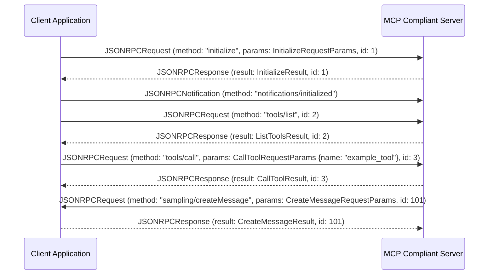

# Model Context Protocol (MCP) v2025-06-18

This document outlines the message structures used for communication within the OmniXy system, adhering to the Model Context Protocol (MCP) specification version 2025-06-18. MCP uses JSON-RPC 2.0 for message transport.

## JSON-RPC Core Concepts

All MCP communication occurs via JSON-RPC messages. There are three main types:

1.  **Request (`JSONRPCRequest`)**: An operation invoked by the sender that expects a response from the receiver. It includes `jsonrpc`, `id`, `method`, and `params`.
2.  **Response (`JSONRPCResponse` / `JSONRPCErrorResponse`)**: The reply to a Request. It includes `jsonrpc`, `id`, and either `result` (for success) or `error` (for failure).
3.  **Notification (`JSONRPCNotification`)**: An operation invoked by the sender that does *not* expect a response. It includes `jsonrpc`, `method`, and `params`.

## Key MCP Structures (Python Pydantic Models)

The Python implementation uses Pydantic models, largely mirroring the [official TypeScript schema](https://github.com/modelcontextprotocol/specification/blob/main/schema/2025-06-18/schema.ts).

### Common Base Models

-   `BaseMetadata`: Contains `name` and optional `title`.
-   `Implementation`: Extends `BaseMetadata` with `version`.
-   `RequestParams`: Base for parameters in requests, includes optional `_meta` (e.g., for `progressToken`).
-   `BaseResult`: Base for results in responses, includes optional `_meta`.
-   `Annotations`: Optional metadata like `audience`, `priority`, `lastModified`.

### Initialization Flow

1.  **Client -> Server: `InitializeRequest`**
    -   `method: "initialize"`
    -   `params`:
        -   `protocolVersion`: Client's supported MCP version.
        -   `capabilities`: `ClientCapabilities` (what the client can do, e.g., `roots`, `sampling`, `elicitation`).
        -   `clientInfo`: `Implementation` details of the client.
2.  **Server -> Client: `InitializeResult`** (within `JSONRPCResponse`)
    -   `result`:
        -   `protocolVersion`: Server's chosen MCP version.
        -   `capabilities`: `ServerCapabilities` (what the server offers, e.g., `logging`, `prompts`, `resources`, `tools`).
        -   `serverInfo`: `Implementation` details of the server.
        -   `instructions` (optional): How to use the server.
3.  **Client -> Server: `InitializedNotification`**
    -   `method: "notifications/initialized"`
    -   Signals that the client is ready.

### Core Features (Server-Offered)

#### Resources

-   **`ListResourcesRequest`** (Client -> Server): Asks for available resources.
    -   `method: "resources/list"`
    -   Supports pagination (`cursor`).
-   **`ListResourcesResult`** (Server -> Client): Provides a list of `Resource` objects.
    -   `Resource`: `uri`, `description`, `mimeType`, `annotations`, `size`.
-   **`ReadResourceRequest`** (Client -> Server): Asks to read a specific resource.
    -   `method: "resources/read"`
    -   `params`: `uri`.
-   **`ReadResourceResult`** (Server -> Client): Provides resource content.
    -   `contents`: List of `TextResourceContents` (`text`) or `BlobResourceContents` (`blob`).
-   **Notifications**:
    -   `notifications/resources/list_changed`: Server informs client that resource list changed.
    -   `notifications/resources/updated`: Server informs client that a subscribed resource changed (after `resources/subscribe` request).

#### Prompts

-   **`ListPromptsRequest`** (Client -> Server): Asks for available prompts/templates.
    -   `method: "prompts/list"`
-   **`ListPromptsResult`** (Server -> Client): Provides a list of `Prompt` objects.
    -   `Prompt`: `name`, `description`, `arguments` (`PromptArgument`: `name`, `description`, `required`).
-   **`GetPromptRequest`** (Client -> Server): Asks for a specific prompt.
    -   `method: "prompts/get"`
    -   `params`: `name`, optional `arguments` for templating.
-   **`GetPromptResult`** (Server -> Client): Provides the prompt.
    -   `messages`: List of `PromptMessage` (`role`, `content` which is `ContentBlock`).
        -   `ContentBlock`: Can be `TextContent`, `ImageContent`, `AudioContent`, `ResourceLink`, or `EmbeddedResource`.
-   **Notification**: `notifications/prompts/list_changed`.

#### Tools

-   **`ListToolsRequest`** (Client -> Server): Asks for available tools.
    -   `method: "tools/list"`
-   **`ListToolsResult`** (Server -> Client): Provides a list of `Tool` objects.
    -   `Tool`: `name`, `description`, `inputSchema`, `outputSchema` (JSON schema), `annotations` (`ToolAnnotations` like `readOnlyHint`, `destructiveHint`).
-   **`CallToolRequest`** (Client -> Server): Invokes a tool.
    -   `method: "tools/call"`
    -   `params`: `name`, optional `arguments`.
-   **`CallToolResult`** (Server -> Client): Result of the tool call.
    -   `content`: List of `ContentBlock`.
    -   `structuredContent` (optional): JSON object.
    -   `isError` (optional): Boolean.
-   **Notification**: `notifications/tools/list_changed`.

### Client Features (May be Requested by Server)

#### Sampling (LLM Interaction via Client)

-   **`CreateMessageRequest`** (Server -> Client): Server asks client to query an LLM.
    -   `method: "sampling/createMessage"`
    -   `params`:
        -   `messages`: List of `SamplingMessage` (`role`, `content` which is `TextContent`, `ImageContent`, or `AudioContent`).
        -   `modelPreferences`: `ModelPreferences` (`hints`, `costPriority`, `speedPriority`, `intelligencePriority`).
        -   `systemPrompt`, `temperature`, `maxTokens`, etc.
-   **`CreateMessageResult`** (Client -> Server): Client's LLM response.
    -   Inherits `SamplingMessage` fields (`role`, `content`).
    -   `model`: Name of the model used.
    -   `stopReason`.

#### Roots (Filesystem Boundaries)

-   **`ListRootsRequest`** (Server -> Client): Server asks for root URIs (e.g., project directories).
    -   `method: "roots/list"`
-   **`ListRootsResult`** (Client -> Server): Client provides a list of `Root` objects.
    -   `Root`: `uri` (e.g., `file:///path/to/dir`), `name`.
-   **Notification**: `notifications/roots/list_changed` (Client -> Server).

#### Elicitation (Requesting User Input)

-   **`ElicitRequest`** (Server -> Client): Server asks client to get input from the user.
    -   `method: "elicitation/create"`
    -   `params`: `message` (to show user), `requestedSchema` (simplified JSON schema for the form).
-   **`ElicitResult`** (Client -> Server): User's response.
    -   `action`: `"accept"`, `"decline"`, or `"cancel"`.
    -   `content` (if "accept"): User-provided data.

### Other Important MCP Messages

#### Notifications (General)

-   **`CancelledNotification`**: Sent by either side to cancel an in-flight request.
    -   `method: "notifications/cancelled"`, `params: { requestId, reason }`
-   **`ProgressNotification`**: Out-of-band progress updates for long-running requests.
    -   `method: "notifications/progress"`, `params: { progressToken, progress, total, message }`

#### Logging

-   **`SetLevelRequest`** (Client -> Server): Client requests a specific logging level.
    -   `method: "logging/setLevel"`, `params: { level }`
-   **`LoggingMessageNotification`** (Server -> Client): Server sends a log message.
    -   `method: "notifications/message"`, `params: { level, logger, data }`

#### Ping/Pong

-   **`PingRequest`**: Sent by either side to check connectivity.
    -   `method: "ping"`
-   The receiver responds with an `EmptyResult` for a "pong".

## Streaming Responses

The MCP spec primarily uses notifications (like `notifications/progress` or custom notifications) for streaming. The previous `MCPPartialResponse` from this codebase is not a standard JSON-RPC message but can be adapted to be part of a notification's `params` if partial streaming of content is needed (e.g., token by token from an LLM).

```python
class MCPPartialResponse(BaseModel):
    """
    Represents a piece of a streaming response.
    This is NOT a standard JSON-RPC message type.
    It would typically be part of a `notifications/progress` `params` or a custom notification.
    """
    partial_text: Optional[str] = None
    data_chunk: Optional[Any] = None
    is_final_chunk: bool = Field(default=False)
    metadata: Dict[str, Any] = Field(default_factory=dict)
    error: Optional[Dict[str, Any]] = None
```

## Message Flow (High-Level Example)



## Best Practices (Aligned with MCP Spec)

1.  **Message Validation**: Adhere strictly to the defined Pydantic models which are based on the MCP JSON schema.
2.  **Error Handling**: Use `JSONRPCErrorResponse` with appropriate error codes (e.g., `-32600 Invalid Request`, `-32601 Method not found`, `-32602 Invalid params`, `-32603 Internal error`) and messages. Tool-specific errors should often be reported within a successful `CallToolResult` by setting `isError: true`.
3.  **Security and Trust & Safety**: Implementors MUST follow the guidelines in the MCP specification regarding user consent, data privacy, tool safety, and LLM sampling controls.
4.  **Capabilities Negotiation**: Utilize the `capabilities` exchange during initialization to determine supported features.
5.  **Cancellation**: Support `notifications/cancelled` for long-running operations.
6.  **Progress Reporting**: Use `notifications/progress` for operations that take time.

This document provides an overview. For authoritative details, always refer to the [official MCP Specification v2025-06-18](https://modelcontextprotocol.io/specification/2025-06-18/) and its [TypeScript schema](https://github.com/modelcontextprotocol/specification/blob/main/schema/2025-06-18/schema.ts).
